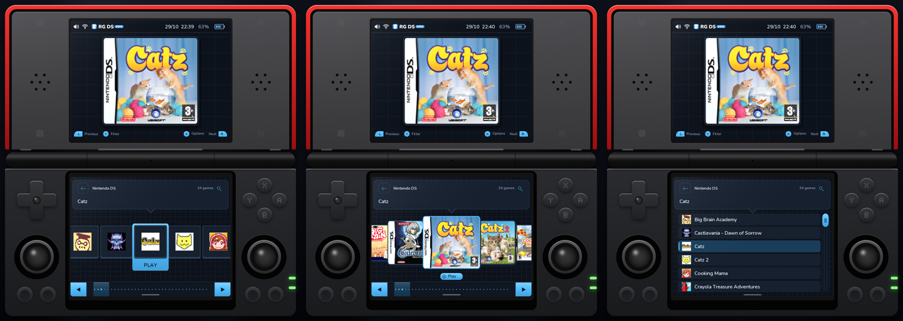

<p align="center">
  <picture>
    <source media="(prefers-color-scheme: dark)" srcset="assets/brand/lockup-dark.svg">
    
  </picture>
</p>

**Our own operating system for the Anbernic RG DS and RG DS Plus.** A lightweight Linux image that boots straight into a DSi-style library in a few seconds, plays DS, GBA, Game Boy, PSP and more, and sleeps when you close the lid.


> **Early release.** RG DS OS 0.9.1 is the latest public image. The RG DS and the RG DS Plus are both fully supported. This page describes the current source, which is ahead of 0.9.1; some newer features are not yet tested on a handheld.

## Features

### DS games

- DSCore: 2x-5x 3D (heavy games can glitch or slow down), fast-forward and low input latency. [Engine](dscore/README.md)
- Microphone (or simulated blowing), lid, DS language, name and birthday, Rumble Pak.
- Local wireless between handhelds and with melonDS, and online play through Wiimmfi or WiiLink.
- DSiWare (experimental).

### Two screens

- Maps, HUDs, teams and battle panels on the bottom screen. [Games](docs/PLAY.md)
- Touch keyboards and keypads for computers and consoles, a touch mouse for DOS.
- Arcade vertical games across both panels, two-monitor cabinets, Game & Watch, Virtual Boy in 3D.
- Game manuals (PDF or CBZ) beside the game, for systems other than DS.

### While you play

- One menu: pause, checkpoints with previews and undo, game switcher and settings. [Saves](docs/SAVES.md)
- Rewind on most systems, fast-forward, auto-save and resume after power off.
- [Cheats](docs/CHEATS.md) and [RetroAchievements](https://retroachievements.org/).
- Button mapping per game, left stick as D-pad, rumble.
- 30+ shaders and LCD filters, Game Boy colour screens, console bezels and your own, defaults per system.
- [Screenshots](docs/SCREENSHOTS.md) with Menu + R.

### Systems

| | |
| --- | --- |
| **Nintendo** | DS, DSiWare, 3DS (experimental), N64, SNES, NES and Famicom Disk System, GBA, Game Boy and Color, Virtual Boy, Game & Watch |
| **Sega** | Dreamcast, Mega Drive, 32X, Mega-CD, Pico, Master System, Game Gear, SG-1000 |
| **Sony** | PlayStation, PSP |
| **Atari** | 2600, 5200, 7800, Lynx |
| **Computers** | DOS, Amiga, Commodore 64, ZX Spectrum, Amstrad CPC, MSX |
| **Handhelds and more** | PC Engine and CD, WonderSwan and Color, Neo Geo Pocket and Color, ColecoVision, Intellivision, arcade, PICO-8, ScummVM, Flash (with Flashpoint packs) |

### Library

- Covers, list or cartridges. Pinch with a finger on each screen to zoom out to a wall of games.
- Search, filters, favourites, recents, hidden games and a Game info page with pictures.
- [Artwork](docs/SCREENSCRAPER.md) and game info from GameTDB, Libretro or ScreenScraper.
- Free homebrew shelves for DS, GBA and NES.
- A second game card in the RG DS Plus.

### Players

- [Profiles](docs/PROFILES.md) with their own saves, look and language.
- Kid profiles with age limits and a PIN; Little kid is one screen of big pictures.
- Play time, streaks, a play journal with a year recap, and "Where you left off".

### Apps

- **[PortMaster ports](https://portmaster.games/)**, with game files sent from your phone by QR code, and [your own apps](docs/APPS.md).
- **Media:** [music](docs/MUSIC.md) with equaliser and visualisers, videos with subtitles, and books, comics and manga.
- **Files:** copy, move, zip and trash, plus SMB and SFTP network folders.
- **Album:** photo mode, and send pictures to your phone or PictoChat.
- **[PictoChat](docs/PICTOCHAT.md):** our own Wi-Fi chat between handhelds.
- **[Sound toy](docs/SOUND_TOY.md):** change your voice and make it the startup sound.
- A hidden game, if you find it.

### The system

- First-boot setup that can bring saves over from another card.
- Quick boot, low memory use, true sleep on lid close, idle dimming and a sleep timer.
- Power modes, battery health and a safe shutdown on low battery.
- Wi-Fi, Bluetooth controllers and headphones (aptX, aptX HD, LDAC).
- File sharing, SSH, USB-C network and USB drive.
- Signed over-the-air updates with automatic rollback. [More](docs/OTA.md)
- One card image for both handhelds, with sharper menus on the RG DS Plus.

### Make it yours

- Light and dark, 16 DS favourite colours, high contrast, rounded or pixel style.
- Carousel or column Home, touch gestures, animations, haptics, menu sounds and music.
- 23 [languages](docs/I18N.md), time zones and daylight saving.




## Install

1. Download **RG DS Flasher** for [Windows](https://github.com/kleinrein/rgds-core/releases/latest/download/RG-DS-Flasher-Windows.exe), [macOS](https://github.com/kleinrein/rgds-core/releases/latest/download/RG-DS-Flasher-macOS.zip) or [Linux](https://github.com/kleinrein/rgds-core/releases/latest/download/RG-DS-Flasher-Linux-x64) and open it. Put a spare microSD card (8 GB or more) in your computer, pick it and press Flash. It downloads the latest RG DS OS, writes it, checks it and ejects the card. It can also preset your language and Wi-Fi, keep saves from a BananaOS or stock card, and back up or restore a whole card. [More about the flasher](flasher/README.md)
2. Put the card in and power on. First boot sets up the rest of the card, then a short setup asks for your language, colour, name, Home and animations, DS or all systems, time and Wi-Fi, and shows how to add games. Every step can be skipped.
3. Join Wi-Fi in Settings and turn on file sharing. Copy games into `roms/nds`, `roms/gba` and so on from a computer, over Wi-Fi, USB-C or as a USB drive.

Prefer doing it by hand? Download `RG-DS-OS-<version>.img.gz` from [releases](https://github.com/kleinrein/rgds-core/releases) (it works on the RG DS and the RG DS Plus), check it against its `.sha256` and write it with [balenaEtcher](https://etcher.balena.io) or Raspberry Pi Imager. Not Rufus: its cards stay black.

**Controls:** A plays, B goes back, Y is Filter, X is Options, L2/R2 jump by letter. In a game, Home opens the menu and R2 fast-forwards.

**Coming from v0.7.0?** It was an add-on for the stock firmware and cannot update itself into the OS. Use a second card, back up saves with Settings → Library → Back up all saves, and copy games over. v0.7.0 stays on its [release page](https://github.com/kleinrein/rgds-core/releases/tag/v0.7.0) but gets no more updates.

## Good to know

- No games, BIOS files or cover art included, and no Nintendo or Anbernic files.
- Other systems are off until you turn on Settings → Library → Systems → All systems.
- Each engine keeps its own saves.

## BIOS files

Most systems need none. For the rest, copy your own files into `rgds/bios` (shown as `bios` when file sharing is on), with these exact names, then restart the game.

<details>
<summary>BIOS files by system</summary>

| System (core)                              | BIOS                                 | File name(s)                                | Notes                                                                                           |
| ------------------------------------------ | ------------------------------------ | ------------------------------------------- | ----------------------------------------------------------------------------------------------- |
| PlayStation (PCSX ReARMed)                 | Recommended                          | `scph5501.bin` (US), `scph5500.bin` (JP), `scph5502.bin` (EU) | Without one a built-in replacement runs, but some games fail or glitch.                |
| PC Engine CD-ROM (Beetle PCE Fast)         | **Required for discs**               | `syscard3.pce`                              | Cards (`.pce`) need nothing.                                                                    |
| Mega-CD / Sega CD (PicoDrive)              | **Required for discs**               | `bios_CD_U.bin` (US), `bios_CD_E.bin` (EU), `bios_CD_J.bin` (JP) | Cartridge games need nothing.                                              |
| ColecoVision (Gearcoleco)                  | **Required**                         | `colecovision.rom`                          |                                                                                                 |
| Intellivision (FreeIntv)                   | **Required**                         | `exec.bin`, `grom.bin`                      |                                                                                                 |
| Dreamcast (Flycast)                        | Recommended                          | `dc/dc_boot.bin`, `dc/dc_flash.bin`         | Goes in a `dc` subfolder. Without it Flycast's built-in BIOS boots most games.                  |
| Amiga (PUAE)                               | Recommended                          | A Kickstart ROM whose name starts with `kick` or `amiga-os-` (or contains `kickstart`) | Without one it starts on the free AROS. WHDLoad sets and many games need a real Kickstart. |
| MSX (blueMSX)                              | Disks and tapes: **required**        | The machine folders from RetroArch's blueMSX pack, copied into the folder | Cartridges run on the free C-BIOS the image supplies.                       |
| Atari 7800 (ProSystem)                     | Optional                             | `7800 BIOS (U).rom`                         | Shows the Atari logo first.                                                                     |
| Atari 5200 (a5200)                         | Optional                             | `5200.rom`                                  | Without it the free Altirra OS runs. A few games need the real one.                             |
| Atari Lynx (Handy)                         | Optional                             | `lynxboot.img`                              | Without it the core starts the cartridge itself.                                                |
| DSiWare (DSCore)                           | **Required**                         | `bios9.bin`, `bios7.bin`, `dsi_bios9.bin`, `dsi_bios7.bin` | All four: the DS pair and the DSi pair (melonDS's and DraStic's names work too, also in an `nds` subfolder). DS games need none. DSiWare goes in the DS folder as `.nds`, `.dsi`, `.srl` or a decrypted `.cia`; its saves are kept per player as `GAMECODE.pub`/`.prv`, and each player gets a DSi SD card folder. No camera yet. |

</details>

## Thanks

RG DS Core stands on a lot of other people's work. Thank you all.

**[DSperate](https://github.com/beebono/DSperate)** by beebono is the heart of it. DSCore, the DS engine here, is a fork of DSperate ([what we changed](dscore/FORK.md)), and every DS game you play on this handheld runs on its recompiler, renderer and timing. Thanks also to everyone who sends it fixes; several of theirs are in DSCore too.

<details>
<summary>Everyone else</summary>

DSperate itself builds on two emulators it learned from:

- **DraStic** by Exophase, whose JIT and NEON rendering techniques DSperate reimplements from scratch. Exophase approved sharing the debug build those techniques were studied from.
- **[melonDS](https://github.com/melonDS-emu/melonDS)**, the reference DSperate checks itself against, frame by frame and instruction by instruction. Its local wireless protocol lets an RG DS play with a melonDS user. Its DSi DSP programs and its copy of [teakra](https://github.com/wwylele/teakra) (with [FAAD2](https://github.com/knik0/faad2) for AAC) are how DSiWare's DSP sound runs here.

**Other emulators**

- [mGBA](https://github.com/mgba-emu/mgba) for GBA, Game Boy and Game Boy Color in RG DS Play.
- [Tanuki3DS](https://github.com/burhanr13/Tanuki3DS) for the Nintendo 3DS.
- [Ruffle](https://github.com/ruffle-rs/ruffle) for Flash games, with packs from [Flashpoint Archive](https://flashpointarchive.org/).
- The [libretro](https://www.libretro.com/) project and the authors of every core we ship: FCEUmm, Snes9x, PicoDrive, Beetle PCE Fast, Mupen64Plus-Next, PCSX ReARMed, PPSSPP, Flycast, Fuse, VICE, PUAE, DOSBox Pure, blueMSX, Caprice32, Stella 2014, ProSystem, a5200, Handy, Beetle VB, Beetle WonderSwan, Beetle NeoPop, Gearcoleco, FreeIntv, fake-08, gw-libretro, FinalBurn Neo, MAME 2003-Plus and ScummVM.

**The system underneath**

- [BananaLinux](https://github.com/JorreFog/BananaLinux) by JorreFog, whose RG DS board layer RG DS OS started from, and [ROCKNIX](https://github.com/ROCKNIX/distribution), whose kernel patches, panel and joypad drivers made the hardware work.
- [Buildroot](https://buildroot.org/), the Linux kernel, [Mesa](https://mesa3d.org/)'s Panfrost and PanVK (with the [FristOneRR PanVK](https://github.com/FristOneRR-Admin/FristOneRR-Panvk-Source) tree), [SDL](https://www.libsdl.org/), [Samba](https://www.samba.org/), [libslirp](https://gitlab.freedesktop.org/slirp/libslirp), miniz, FFmpeg, libopenmpt, mpv and bluez-alsa with libopenaptx and libldac.
- [PortMaster](https://portmaster.games/) and its port makers, for the hundreds of ports that run here.

**Online services and game knowledge**

- [RetroAchievements](https://retroachievements.org/) and its rcheevos library.
- [Wiimmfi](https://wiimmfi.de/) and WiiLink, which keep DS online play alive.
- [GameTDB](https://www.gametdb.com/), [ScreenScraper](https://www.screenscraper.fr/), [libretro-thumbnails](https://github.com/libretro-thumbnails/libretro-thumbnails) and the [libretro database](https://github.com/libretro/libretro-database) for covers and game information.
- [GBA DS](https://github.com/kyannon/gba-ds) by kyannon, whose shadow-map idea became our second-screen maps; the [pret](https://github.com/pret) and other disassembly projects and [Data Crystal](https://datacrystal.tcrf.net/) for the memory maps behind them.

**Looks and sound**

- jdgleaver's [DraStic DS shaders](https://github.com/jdgleaver/drastic_ds_shaders), Pokefan531's GBA colour model, SameBoy's Game Boy palettes and the [Nunito](https://github.com/google/fonts/tree/main/ofl/nunito) typeface.
- Nintendo's DSi Menu, which the look of the launcher pays homage to, and the Nokia phones Snake came from.

</details>

Licences and exact versions are in [THIRD_PARTY.md](THIRD_PARTY.md).

## Developing

```sh
make preview        # launcher on your computer
make test           # tests
make package        # the release inside the image (needs the engine payloads)
make image          # RG DS OS card image (Buildroot in a Lima VM)
make push           # the image into the handheld's other slot, over SSH
make release        # card image, signed update and feed in dist/release-os/ (uploads nothing)
```

See [development](docs/DEVELOPMENT.md), the [documentation index](docs/README.md) and [releases with automatic updates](docs/OTA.md). The emulator lives in [`dscore/`](dscore/README.md).

AI tools helped write the code, documentation and artwork. Third-party components keep their own licenses; see [THIRD_PARTY.md](THIRD_PARTY.md).
