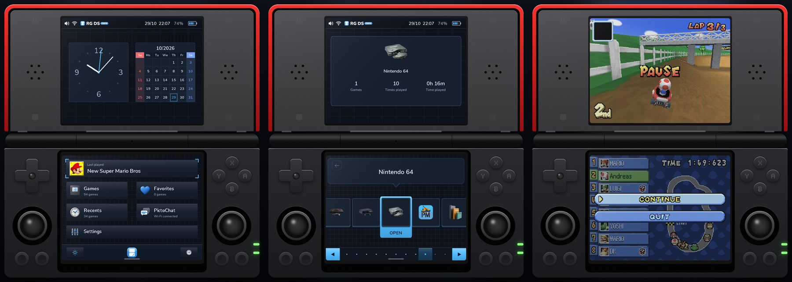
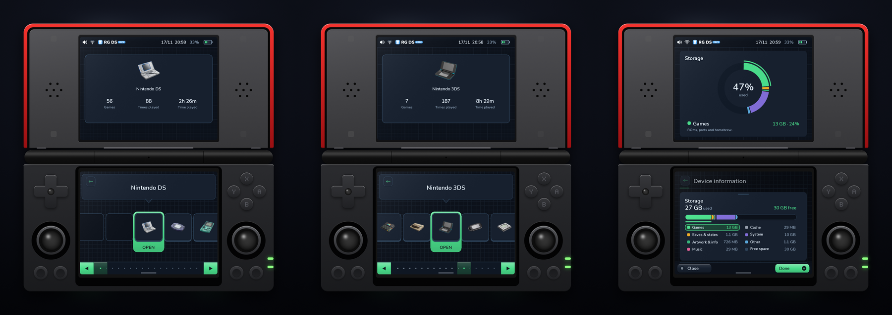
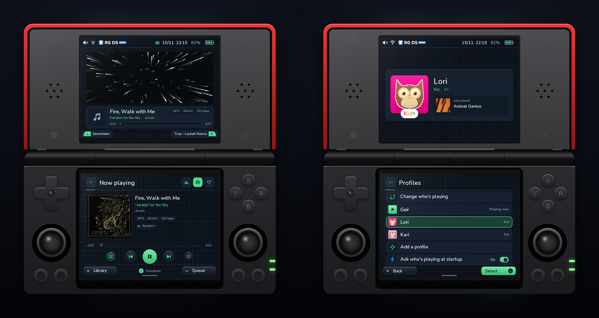
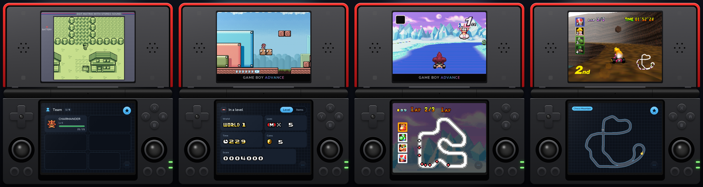
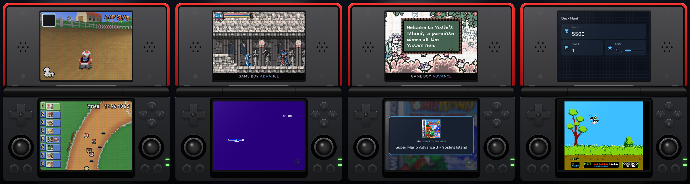

<p align="center">
  <picture>
    <source media="(prefers-color-scheme: dark)" srcset="assets/brand/lockup-dark.svg">
    
  </picture>
</p>

**Our own operating system for the Anbernic RG DS.** A lightweight Linux image that boots straight into a DSi-style library in a few seconds, plays DS, GBA, Game Boy, PSP and more, and sleeps when you close the lid.



> **Early release.** RG DS OS 0.9.1 is the latest public image. The standard RG DS is tested; the RG DS Plus runs the same image but is still being checked ([Plus tester guide](docs/RG_DS_PLUS_TEST.md)). Details in [Status](#status).

## What you get

- **A real OS:** Quick boot, low RAM consumption and fast game starts.
- **DS games in DSCore:** sharp 2x-5x 3D (heavy games can glitch or slow down), 32 shaders and LCD filters, fast-forward, low input latency.
- **More systems:** GBA, GB and GBC in RG DS Play, plus NES, SNES, Master System (with Game Gear and SG-1000), Mega Drive (with Mega-CD and Sega Pico), PC Engine (with CD-ROM), N64, PlayStation, PSP, Dreamcast, ZX Spectrum, Commodore 64, Amiga, DOS (through DOSBox Pure), MSX, Amstrad CPC, Atari 2600, 5200 and 7800, Atari Lynx, WonderSwan (and Color), Neo Geo Pocket (and Color), Virtual Boy (red on black, or in 3D with one eye on each screen), ColecoVision, Intellivision, PICO-8 (through fake-08), Game & Watch, Nintendo's two-monitor arcade cabinets (Punch-Out!!, Super Punch-Out!! and the Vs. dual games, one monitor per screen) ScummVM and Flash games (through Ruffle, with Flashpoint Archive packs imported). Nintendo 3DS is experimental.
- **Dual screen mode:** maps, HUDs and your team on the bottom panel. See [the games](#second-screen-games).
- **One in-game menu for every system:** pause, checkpoints, cheats, game switcher, settings.
- **Library:** covers, list or cartridges. Search, favourites, recents, play time, and artwork and game info fetched for you.
- **Profiles:** everyone who plays gets their own saves, favourites and look. A Kid profile shows games for its age and locks the settings with a PIN. [More](docs/PROFILES.md)
- **Music player:** your own music from the card, MP3 and FLAC to tracker modules. [More](docs/MUSIC.md)
- **PortMaster ports**.
- **PictoChat:** our own Wi-Fi chat between handhelds, no Nintendo files. [More](docs/PICTOCHAT.md)
- **Sound toy:** record your voice and play it back as a chipmunk, robot, monster or backwards, draw to bend it, and make it the startup sound. [More](docs/SOUND_TOY.md)
- **Safe updates:** signed, over Wi-Fi, into a second system slot. A bad update rolls back by itself, and Use previous build takes you back by hand. [More](docs/OTA.md)
- **True sleep and power modes:** the lid puts it to rest on very little power; pick a power mode to trade speed for battery and heat.
- **Yours:** light/dark, accent colours, 23 languages, menu sounds and music.






## Second-screen games

The game plays on the top panel. The bottom panel shows what the game hides. A selection:

| Game                                           | Bottom screen                |
| ---------------------------------------------- | ---------------------------- |
| Metroid Fusion, Zero Mission                   | Map                          |
| Metroid, Super Metroid, Metroid II             | Explored-area map            |
| Castlevania: Aria, Harmony, Circle of the Moon | Castle map                   |
| The Legend of Zelda (NES, A Link to the Past)  | World and dungeon maps       |
| The Legend of Zelda: The Minish Cap            | Hearts, items and collection |
| Pokémon (Red to Emerald)                       | Live team and battle panel   |
| Mario Kart: Super Circuit                      | HUD, course map              |
| Super Mario Kart                               | Course map                   |
| Mario Kart 64                                  | Whole course and your place  |
| Wario Land, Super Mario Advance 2 and 4        | Status board                 |
| Golden Sun                                     | Live party panel             |
| Advance Wars                                   | Commander and terrain panels |



Over 50 games have profiles. Everything else shows a title card and plays as normal. [Full list](docs/PLAY.md)



## Install

1. Download **RG DS Flasher** for [Windows](https://github.com/kleinrein/rgds-core/releases/latest/download/RG-DS-Flasher-Windows.exe), [macOS](https://github.com/kleinrein/rgds-core/releases/latest/download/RG-DS-Flasher-macOS.zip) or [Linux](https://github.com/kleinrein/rgds-core/releases/latest/download/RG-DS-Flasher-Linux-x64) and open it. Put a spare microSD card (8 GB or more) in your computer, pick it and press Flash. It downloads the latest RG DS OS, writes it, checks it and ejects the card. [More about the flasher](flasher/README.md)
2. Put the card in and power on. First boot sets up the rest of the card, then a short setup asks for your language, colour, name, Home and animations, DS or all systems, time and Wi-Fi, and shows how to add games. Every step can be skipped.
3. Join Wi-Fi in Settings and turn on file sharing. Copy games into `roms/nds`, `roms/gba` and so on from a computer, over Wi-Fi, USB-C or as a USB drive.

Prefer doing it by hand? Download `RG-DS-OS-<version>.img.gz` from [releases](https://github.com/kleinrein/rgds-core/releases) (it works on the RG DS and the RG DS Plus), check it against its `.sha256` and write it with [balenaEtcher](https://etcher.balena.io) or Raspberry Pi Imager. Not Rufus: its cards stay black.

**Controls:** A plays, B goes back, Y is Filter, X is Options, L2/R2 jump by letter. In a game, Home opens the menu and R2 fast-forwards.

**Coming from v0.7.0?** It was an add-on for the stock firmware and cannot update itself into the OS. Use a second card, back up saves with Settings → Library → Back up all saves, and copy games over. v0.7.0 stays on its [release page](https://github.com/kleinrein/rgds-core/releases/tag/v0.7.0) but gets no more updates.

## Good to know

- No games, BIOS files or cover art included, and no Nintendo or Anbernic files.
- Other systems are off until you turn on Settings → Library → Systems → All systems.
- Each engine keeps its own saves.

## BIOS files

Most systems run with nothing extra. A few need, or run better with, a BIOS from your own console. None are included, so you have to dump or find them yourself.

**Where they go:** in one folder, `rgds/bios`, on the card's data partition next to `roms`. With file sharing on, it shows up as `bios` beside the game folders, over Wi-Fi, USB-C or as a USB drive. Copy the files in with the exact names below, with no subfolders unless the table says so. Restart the game afterwards.

| System (core)                              | BIOS                                 | File name(s)                                | Notes                                                                                           |
| ------------------------------------------ | ------------------------------------ | ------------------------------------------- | ----------------------------------------------------------------------------------------------- |
| PlayStation (PCSX ReARMed)                 | Recommended                          | `scph5501.bin` (US), `scph5500.bin` (JP), `scph5502.bin` (EU) | Without one a built-in replacement runs, but some games fail or glitch.                |
| PC Engine CD-ROM (Beetle PCE Fast)         | **Required for discs**               | `syscard3.pce`                              | Cards (`.pce`) need nothing.                                                                    |
| Mega-CD / Sega CD (PicoDrive)              | **Required for discs**               | `bios_CD_U.bin` (US), `bios_CD_E.bin` (EU), `bios_CD_J.bin` (JP) | Cartridge games need nothing.                                              |
| ColecoVision (Gearcoleco)                  | **Required**                         | `colecovision.rom`                          |                                                                                                 |
| Intellivision (FreeIntv)                   | **Required**                         | `exec.bin`, `grom.bin`                      |                                                                                                 |
| Dreamcast (Flycast)                        | Recommended                          | `dc/dc_boot.bin`, `dc/dc_flash.bin`         | Goes in a `dc` subfolder. Without it Flycast's built-in BIOS boots most games.                  |
| Amiga (PUAE)                               | Recommended                          | A Kickstart ROM whose name starts with `kick` or `amiga-os-` (or contains `kickstart`) | Without one it starts on the free AROS. WHDLoad sets and many games need a real Kickstart. |
| MSX (blueMSX)                              | Disks and tapes: **required**        | The machine folders from RetroArch's blueMSX pack, copied into the folder | Cartridges run on the free C-BIOS the image supplies.                       |
| Atari 7800 (ProSystem)                     | Optional                             | `7800 BIOS (U).rom`                         | Shows the Atari logo first.                                                                     |
| Atari 5200 (a5200)                         | Optional                             | `5200.rom`                                  | Without it the free Altirra OS runs. A few games need the real one.                             |
| Atari Lynx (Handy)                         | Optional                             | `lynxboot.img`                              | Without it the core starts the cartridge itself.                                                |

No BIOS is needed for DS (DSCore has its own), GBA, Game Boy, NES, SNES, Master System, Mega Drive, N64, PSP, ZX Spectrum, Commodore 64, Amstrad CPC, DOS, Atari 2600, WonderSwan, Neo Geo Pocket, Virtual Boy, PICO-8, Game & Watch, the two-monitor arcade games, ScummVM and Flash.

## Developing

```sh
make preview        # launcher on your computer
make test           # tests
make package        # the release inside the image (needs the engine payloads)
make image          # RG DS OS card image (Buildroot in a Lima VM)
make push           # the image into the handheld's other slot, over SSH
make release        # card image, signed update and feed in dist/release-os/ (uploads nothing)
```

See [development](docs/DEVELOPMENT.md), the [documentation index](docs/README.md) and [releases with automatic updates](docs/OTA.md). The emulator lives in [`dscore/`](dscore/README.md).

AI tools helped write the code, documentation and artwork. Tested on a RG DS, not a plus. Third-party components keep their own licenses; see [THIRD_PARTY.md](THIRD_PARTY.md).
