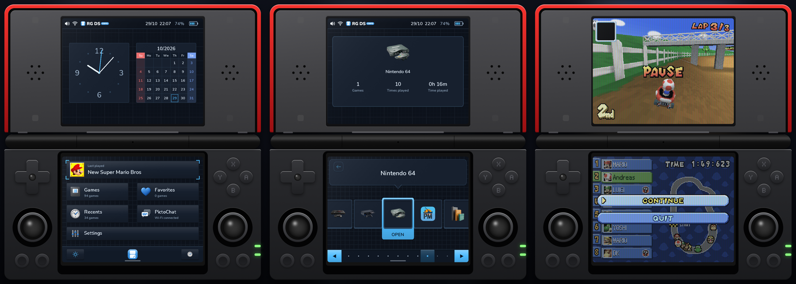
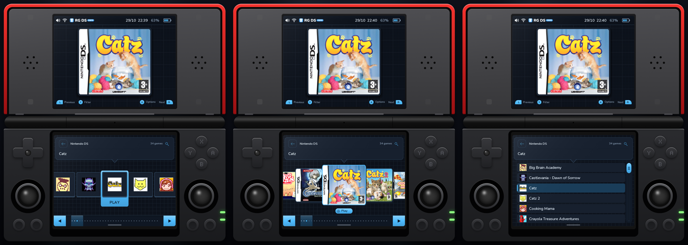
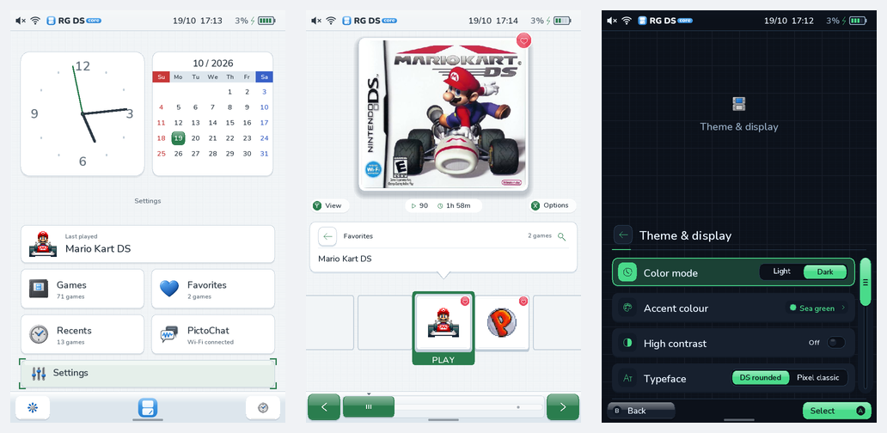
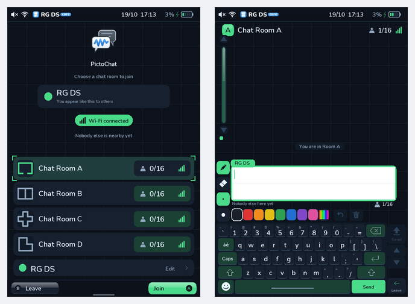
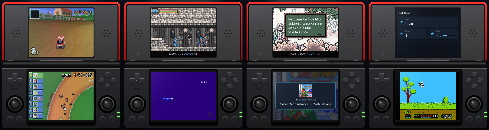

<p align="center">
  <picture>
    <source media="(prefers-color-scheme: dark)" srcset="assets/brand/lockup-dark.svg">
    
  </picture>
</p>

# RG DS Core

A DSi-style home for your games, now on its own operating system. **RG DS Core OS** is a small Linux image for the **Anbernic RG DS** that boots straight into your library within a few seconds, plays Nintendo DS games in **DSCore**, our emulator with sharp 2×–5× 3D (may cause visual glitches and will struggle on high 3D games), plays Game Boy Advance, Game Boy and Game Boy Color games in **RG DS Play** with the game's own map or HUD on the second screen, and sleeps when you close the lid.

It used to be an add-on to Anbernic's stock firmware (up to v0.7.0). It is now the whole system: we own the kernel, the display path, the audio, the power handling and the updates, which is where the speed and the picture quality come from. [Why, and how it works](docs/OWN_OS_PLAN.md).



> **Early release.** RG DS OS 0.8.0 is the first public image. It is tested on one standard RG DS: it boots, plays DS games in DSCore, joins Wi-Fi and updates itself. The RG DS Plus is not supported yet (its device tree is in the repository, nothing is built or tested on it). See [Status](#status). Running **v0.7.0** on the stock firmware? Read [Coming from v0.7.0](#coming-from-v070).

## Highlights

- **Library:** cartridges, covers or a list. Search, A–Z jump, favourites, recents, play time. Covers, descriptions, genres and release dates download by themselves.
- **DSCore:** 3D at native to 5×, switchable mid-game. 32 shaders and LCD filters, plus HD 2D scaling for the flat screens. Fast-forward. Reduced input latency.
- **GBA, GB and GBC:** play them on the same shelf (Settings → Library → Systems → All systems). The second screen shows what the game hides: the map in Metroid Fusion and Castlevania, the HUD in Mario Kart: Super Circuit, your team in Pokémon. About 40 games have profiles. The original screens of the Game Boy, Pocket, Light, Color and GBA, shell frames. [More](docs/PLAY.md).
- **Original in game menu:** pause, checkpoints, cheats, game switcher and game settings, the same for every system.
- **Cheats:** Action Replay codes in DSCore, switched on and off while you play, remembered per game. [More](docs/CHEATS.md).
- **Ports (stock version for now):** PortMaster ports on the same shelf under Settings → Library → Systems → All systems, with the same in-game menu. The libraries the stock firmware lacks download by themselves, so 32-bit ports, desktop-OpenGL ports and Westonpack ports run too. Games that need your own files show a QR code: open it on your phone or computer and drop the files in the browser. Mouse-driven ports can be played by tapping the bottom screen.
- **Other engines:** DraStic, DSperate or melonDS on the stock version; not yet checked on RG DS OS.
- **Tailored:** Light or dark, accent colours, high contrast, rounded or pixel fonts, menu sounds and music, 22 languages including Japanese, Chinese and Korean, all time zones, a drawn icon for every system.
- **PictoChat:** Our homegrown chat client. Wi-Fi rooms between RG DS Core handhelds with pens, stamps, rainbow ink. No Nintendo files. [More](docs/PICTOCHAT.md).
- **Safe updates:** Signed updates over Wi-Fi, installed into the second of two system slots. If a new version does not start, the handheld goes back to the one before by itself, and your games and saves live on their own partition. [More](docs/OTA.md).







## DSCore performance

DSCore is a fork of [DSperate](dscore/FORK.md). 3D goes through Vulkan on the Mali-G52, both screens are composed off the emulation thread.

Input delay: finished frames are handed to the panels directly instead of through the compositor's GL path, which cut the wait from a finished frame to its page flip from about 17–22 ms to 10–12 ms on a standard RG DS (October 2026, measured with the display's own flip timestamps). Touch on that direct path reaches the game as well. [How we measure](docs/PERFORMANCE.md).



## Status

Checked on a standard RG DS (October 2026):

- **Boots to the menu** in about 2.6 s of kernel time, from a card of its own. The stock card is never touched.
- **Both screens and touch** are driven straight from the kernel, with no compositor. Median button-to-frame time 24 ms.
- **DS games run in DSCore**, including 2×–5× 3D and the in-game menu on both screens.
- **Wi-Fi** joins from Settings and is remembered.
- **Updates over Wi-Fi**: 0.7.1 → 0.8.0 installed from the Home banner, into the other slot, then restarted and kept.
- **Uses 89 MiB** of the 2.9 GiB of RAM while idle.

Not done yet: the top screen's touch, and a full pass over GBA/GB/GBC, the other systems, PictoChat, cheats and ports on the new system (the code is shared with the stock version; a few ports and a GBA game have run, most has not been checked). RG DS Plus follows once the standard model is solid. Progress and what is next: [the plan](docs/OWN_OS_PLAN.md).

## Install

**RG DS OS** is a card image. Download `RG-DS-OS-<version>.img.gz` from [releases](https://github.com/kleinrein/rgds-core/releases), check it against its `.sha256`, and write it to a spare microSD card (8 GB or more) with a flasher such as [balenaEtcher](https://etcher.balena.io) or Raspberry Pi Imager. Put the card in, power on: the first boot makes the data partition from the rest of the card. Then join Wi-Fi in Settings, and copy games into `roms/nds`, `roms/gba` and so on from a computer (the data partition is exFAT) or with File sharing. Later versions arrive over Wi-Fi. Swap cards to go back to your stock firmware.

**On the stock firmware?** v0.7.0 was the last add-on release. It keeps working on the **stock linux version V1.0** from its [release page](https://github.com/kleinrein/rgds-core/releases/tag/v0.7.0), but it is no longer maintained and gets no updates.

**Controls:** A plays, B goes back, Y is Filter, X is Options, L2/R2 jump by letter. In a game, Home opens the menu and R2 fast-forwards (change it under Controls).

## Coming from v0.7.0

v0.7.0 is an application on top of Anbernic's firmware, and its over-the-air updates only replace that application. They cannot turn your stock card into RG DS OS, because that means rewriting the card's partitions. So the move is a manual one, and your stock setup is never at risk if you do it with a second card:

- **Keep your v0.7.0 card as it is.** It keeps working exactly as today, and it is your way back to the stock firmware. The handheld has one card slot and boots from whatever card is in it.
- **Use a second microSD card for RG DS OS** (its last partition is exFAT, so your games and saves show up on a computer).
- **Do not flash over your v0.7.0 card** unless you are sure you never want the stock system back. The stock Linux runs from that card.
- **Saves and settings.** Run **Settings → Library → Back up all saves** on v0.7.0 first, then copy the ZIP from `rgds/userdata/exports/` to your computer. The OS keeps the same `rgds/userdata` layout on its data partition, so the folder should carry over, but this has not been tested yet. Battery saves from DSCore are not converted between engines.
- **Games.** `Roms/NDS` becomes `roms/nds` on the new card; GBA, GB and GBC go in `roms/gba`, `roms/gb` and `roms/gbc`. Copy them from your computer.
- **Updates on v0.7.0 will not install RG DS OS, and v0.7.0 gets no more updates.** Its update check will find nothing new.

## Good to know

- RG DS OS: tested on the standard RG DS only.
- No games, BIOS files or cover art included. DSCore and RG DS Play need no BIOS. RG DS OS carries no Nintendo or Anbernic files.
- Other systems are off until you turn on **Settings → Library → Systems → All systems**. Companion screens exist only for the games with a profile; the rest get a title card and play as usual.
- Each engine keeps its own saves.

## Developing

```sh
make preview        # launcher on your computer
make test           # tests
make package        # the release inside the image (needs the engine payloads)
make image          # RG DS OS card image (Buildroot in a Lima VM)
make push           # the image into the handheld's other slot, over SSH
make release        # card image, signed update and feed in dist/release-os/ (uploads nothing)
```

See [development](docs/DEVELOPMENT.md), the [documentation index](docs/README.md) and [releases with automatic updates](docs/OTA.md). The emulator lives in [`dscore/`](dscore/README.md).

AI tools helped write the code, documentation and artwork, so keep backups of your saves. Tested on a RG DS, not a plus. Third-party components keep their own licenses; see [THIRD_PARTY.md](THIRD_PARTY.md).
