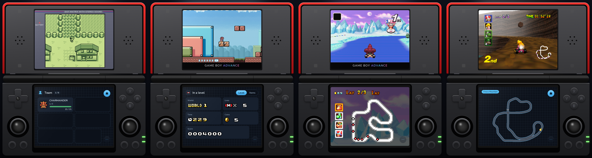

<p align="center">
  <picture>
    <source media="(prefers-color-scheme: dark)" srcset="assets/brand/lockup-dark.svg">
    
  </picture>
</p>

**Our own operating system for the Anbernic RG DS.** A lightweight Linux image that boots straight into a DSi-style library in a few seconds, plays DS, GBA, Game Boy and more, and sleeps when you close the lid.


> **Early release.** RG DS OS 0.8.0 is the first public image. The standard RG DS is tested; the RG DS Plus runs the same image but is still being checked ([Plus tester guide](docs/RG_DS_PLUS_TEST.md)). Details in [Status](#status).

## What you get

- **A real OS:** Quick boot, low RAM consumption and fast game starts.
- **DS games in DSCore:** sharp 2x-5x 3D (heavy games can glitch or slow down), 32 shaders and LCD filters, fast-forward, low input latency.
- **GBA, GB and GBC in RG DS Play**, plus NES, SNES, Master System and N64.
- **Dual screen mode:** maps, HUDs and your team on the bottom panel. See [the games](#second-screen-games).
- **One in-game menu for every system:** pause, checkpoints, cheats, game switcher, settings.
- **Library:** covers, list or cartridges. Search, favourites, recents, play time.
- **PortMaster ports**.
- **PictoChat:** our own Wi-Fi chat between handhelds, no Nintendo files. [More](docs/PICTOCHAT.md)
- **Safe updates:** signed, over Wi-Fi, into a second system slot. A bad update rolls back by itself. [More](docs/OTA.md)
- **Yours:** light/dark, accent colours, 22 languages, menu sounds and music.


## Second-screen games

The game plays on the top panel. The bottom panel shows what the game hides. A selection:

| Game                                           | Bottom screen                |
| ---------------------------------------------- | ---------------------------- |
| Metroid Fusion, Zero Mission                   | Map                          |
| Metroid, Super Metroid, Metroid II             | Explored-area map            |
| Castlevania: Aria, Harmony, Circle of the Moon | Castle map                   |
| The Legend of Zelda (NES, A Link to the Past)  | World and dungeon maps       |
| The Legend of Zelda: The Minish Cap            | Hearts, items and collection |
| Pokémon (Red to Emerald)                       | Live team and battle panel   |
| Mario Kart: Super Circuit                      | HUD, course map              |
| Super Mario Kart                               | Course map                   |
| Mario Kart 64                                  | Whole course and your place  |
| Wario Land, Super Mario Advance 2 and 4        | Status board                 |
| Golden Sun                                     | Live party panel             |
| Advance Wars                                   | Commander and terrain panels |



Over 50 games have profiles. Everything else shows a title card and plays as normal. [Full list](docs/PLAY.md)


## Install

1. Download `RG-DS-OS-<version>.img.gz` from [releases](https://github.com/kleinrein/rgds-core/releases) (it works on the RG DS and the RG DS Plus) and check it against its `.sha256`.
2. Write it to a spare microSD card (8 GB or more) with [balenaEtcher](https://etcher.balena.io) or Raspberry Pi Imager.
3. Put the card in and power on. First boot sets up the rest of the card.
4. Join Wi-Fi in Settings and turn on file sharing. Copy games into `roms/nds`, `roms/gba` and so on from a computer.

**Controls:** A plays, B goes back, Y is Filter, X is Options, L2/R2 jump by letter. In a game, Home opens the menu and R2 fast-forwards.

**Coming from v0.7.0?** It was an add-on for the stock firmware and cannot update itself into the OS. Use a second card, back up saves with Settings → Library → Back up all saves, and copy games over. v0.7.0 stays on its [release page](https://github.com/kleinrein/rgds-core/releases/tag/v0.7.0) but gets no more updates.

## Good to know

- No games, BIOS files or cover art included, and no Nintendo or Anbernic files.
- Other systems are off until you turn on Settings → Library → Systems → All systems.
- Each engine keeps its own saves.

## Developing

```sh
make preview        # launcher on your computer
make test           # tests
make package        # the release inside the image (needs the engine payloads)
make image          # RG DS OS card image (Buildroot in a Lima VM)
make push           # the image into the handheld's other slot, over SSH
make release        # card image, signed update and feed in dist/release-os/ (uploads nothing)
```

See [development](docs/DEVELOPMENT.md), the [documentation index](docs/README.md) and [releases with automatic updates](docs/OTA.md). The emulator lives in [`dscore/`](dscore/README.md).

AI tools helped write the code, documentation and artwork, so keep backups of your saves. Tested on a RG DS, not a plus. Third-party components keep their own licenses; see [THIRD_PARTY.md](THIRD_PARTY.md).
