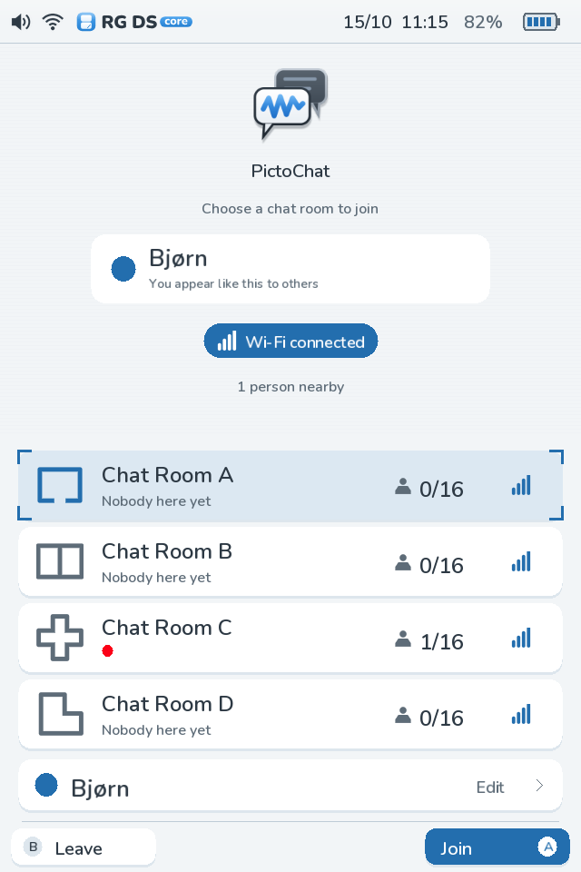
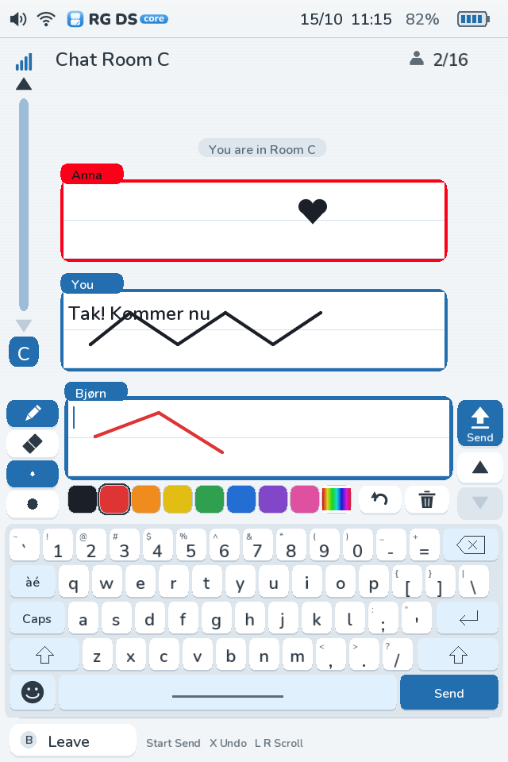

# PictoChat

The fifth tile on the home screen, after Settings, Games, Favourites and Recents,
opens PictoChat: a chat pad for handhelds on the same Wi-Fi network. It is an
original app. It uses no Nintendo code, artwork, BIOS or firmware, and it cannot
talk to the PictoChat built into a real DS or DSi, which uses Nintendo's own
wireless hardware protocol. It talks to other RG DS Core handhelds.





## Using it

1. **The lobby** lists Chat Rooms A to D, as the original does: a floor plan, the people in
   each (3/16, with their colours) and the Wi-Fi bars, with a bracket round the selected
   row. Nobody can see you until you join. Your profile sits below: tap it to change your
   name and colour.
2. **The pad** (lower screen) is one message, two ruled rows tall, under a tab with your
   name. It is drawn larger than the message it holds (540 x 108 on screen for a 480 x 96
   message; touches are mapped back), and the keyboard sits at the very bottom with no
   footer, so the room has as much pad as the DS did. Who else is in the room runs along
   the top as coloured name chips with the head count. Draw with the pen (thin or thick)
   in eight inks or the rainbow, rub out with the eraser (the rules come back), type on
   the keyboard, or place a stamp. **Send** (the tall button beside the pad, or the
   keyboard's Send key) posts it, the arrows under it scroll the log, the undo and bin
   buttons take back the last stroke, letter or stamp or wipe the pad, and the back
   button above the tools leaves the room (so does B).
3. **The log** (upper screen) is the room's messages, each on a card in the sender's
   colour under a tab with their name, with joined and left notices. The header carries
   the room's letter badge, its name, the head count and the Wi-Fi signal; a rail on the
   left has an arrow above and below a recessed track with a glossy thumb in your colour.
   Scrolling eases to its place one message at a time, a new message slides up, and
   while you read older ones the page stays where you left it.

**The keyboard** is the launcher's one keyboard, the same as in search, filters, Wi-Fi and
every other text field, laid out like the original: a number row, QWERTY, Caps, Shift,
Enter and a long space bar. In a room the key beside Q opens the accents (`àé`, then `ABC`
to come back) and the bottom-left key opens the stamp palette; Enter starts the second row of text.

**Colours.** Chat dresses itself in your colour, as the original does. Until you pick one it
is *automatic*: the launcher's accent colour (Settings, Theme & display), so changing the
accent changes PictoChat too. Pick any of the sixteen DS colours in your profile to
override it; the first chip returns to automatic. Others see your messages in the nearest DS
colour. The choice lives in `userdata/pictochat.ini`.

| Control | Action |
| --- | --- |
| Touch | Draw on the pad; tap tools, inks, keys and arrows. Holding an arrow keeps scrolling |
| D-pad | Move over the keyboard; in the lobby, move between rooms |
| A | Press the highlighted key; in the lobby, open the row |
| Start | Send (in the lobby, join) |
| B, Anbernic | Leave the room (so does the back button above the tools); in the lobby, leave PictoChat |
| X / Y | Undo / pen and eraser |
| L, R | Scroll the log older / newer; hold to keep scrolling (the D-pad belongs to the keyboard) |
| L2, R2 | Previous / next ink |

In the host preview a physical keyboard types into the pad; Enter starts the second row,
Backspace deletes, Page Up / Page Down scroll the log and Escape leaves.

## Wi-Fi

Both handhelds need to be on the same network, and the router must let devices see
each other (guest networks and "client isolation" block it). A phone hotspot works.
With no Wi-Fi the pad still works on its own, and your messages stay in your log.

- A small helper, `runtime/pictochat_net.py`, runs only while PictoChat is open. It
  broadcasts on UDP port 49320, so it needs no pairing and no account.
- It listens in the lobby, so room counts are live, but sends nothing until you join.
  Joining announces your name and colour every two seconds; leaving says goodbye.
- Up to 16 people share a room; a seventeenth is told the room is full and stays in the lobby. A message is at most 8 KiB, sent in pieces, twice,
  and shown identically everywhere; a sender is limited to a burst of six messages
  and then three a second.
- The launcher runs as root, so it never reads packets itself. The helper checks every
  datagram, hands over only whole messages, and gives up root as soon as its socket
  is bound. The launcher then decodes each message strictly, with size and range
  limits, and it is fuzz-tested under address and undefined-behaviour sanitizers.
- Messages are not encrypted and names are not verified: anyone on the same network
  in the same room can read what you send and call themselves anything. Use it with
  friends, on a network you trust.

## How it is built

| File | Role |
| --- | --- |
| `src/launcher/keyboard.hpp` | The launcher's one keyboard: layouts for search, text fields and chat, with the accents and stamp layers |
| `src/launcher/pictochat_core.hpp` | A message as a short list of pen, text and stamp operations; the compact binary format, its strict decoder, the anti-aliased pen and the stamps |
| `src/launcher/pictochat_app.hpp` | Rooms, people, the pad, typing, sending, and the helper process |
| `src/launcher/main.cpp` | Drawing and input hooks (search for `PictoChat`) |
| `runtime/pictochat_net.py` | The Wi-Fi helper |
| `tools/build_pictochat_icon.py` | The Home tile's artwork |

Strokes travel as simplified paths rather than pictures, so a busy message is about
1-2 KB. Each handheld replays the same operations with the same font and gets the
same pixels. Typed text is drawn with the launcher's bundled rounded font.
A heavy message (60 strokes, text and six stamps) replays in about 4 ms on a laptop
and a pen segment costs a few microseconds; the handheld has not been timed.

Run two copies against each other on one computer:

```bash
RGDS_PICTOCHAT_ARGS="--port 45101 --bind 127.0.0.1 --targets 127.0.0.1:45102" build/host/rgds-launcher --preview --home --data /tmp/a
RGDS_PICTOCHAT_ARGS="--port 45102 --bind 127.0.0.1 --targets 127.0.0.1:45101" build/host/rgds-launcher --preview --home --data /tmp/b
```

Tests: `tests/test_pictochat_core.py` (format, decoder fuzzing, drawing),
`tests/test_pictochat_app.py` (rooms, typing, layout, every key present in the font,
two apps through two real helpers), `tests/test_pictochat_net.py` (protocol, hostile
packets, two helper processes) and `tests/test_pictochat_ui.py` (the real launcher).

## Not yet verified on the handheld

Everything above is checked on a computer. On the device it still needs: the Wi-Fi
helper finding the interface's broadcast address, two physical handhelds exchanging
messages, drawing latency on the touchscreen, idle power with the pad open, and the
helper's start-up time.
